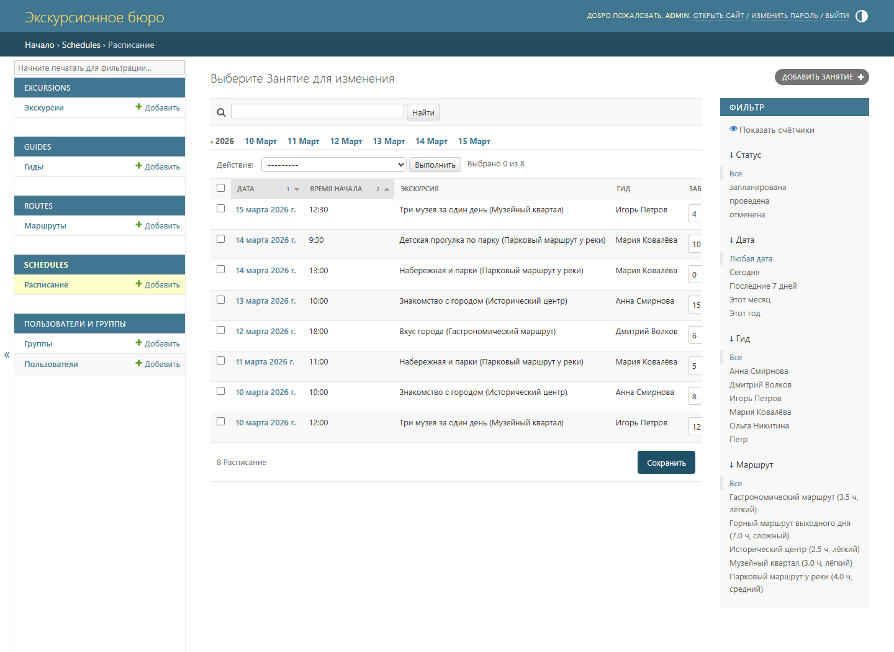
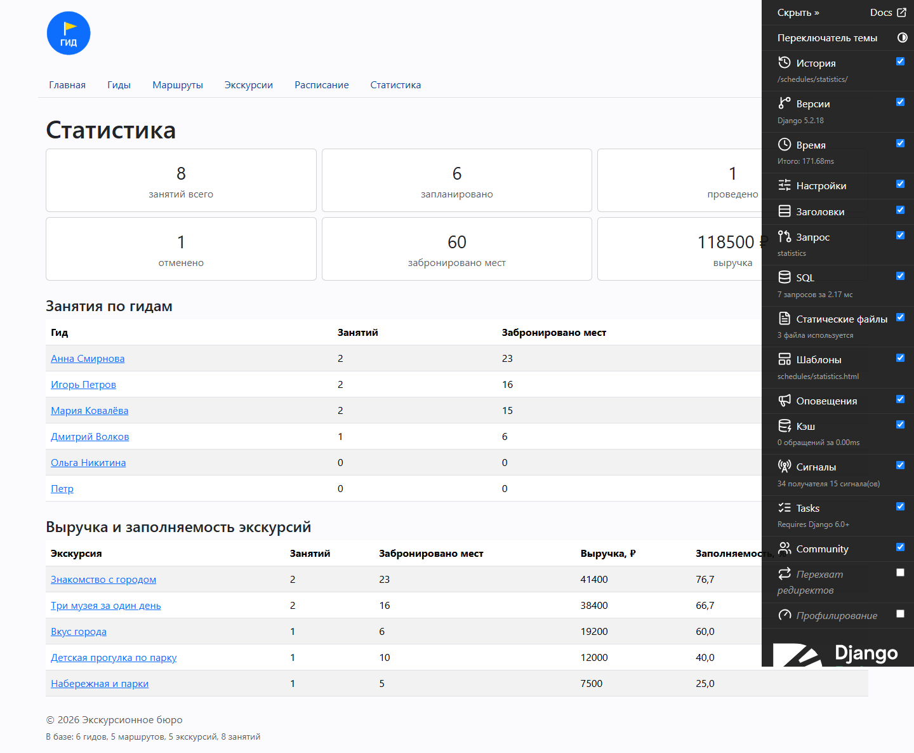
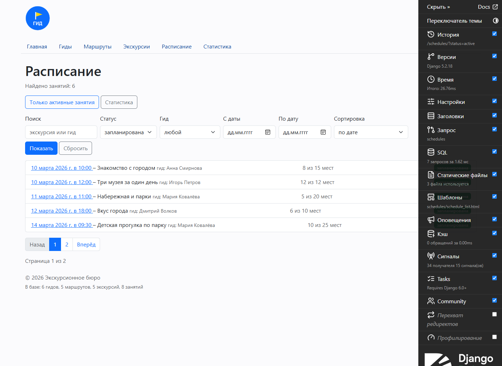

# Отчёт по практической работе № 10

## 1. Общие сведения

| Поле | Значение |
| --- | --- |
| Дисциплина | «Технологии разработки приложений на базе фреймворков» |
| Практическая работа | № 10 |
| Тема | «Административная панель Django и работа с данными через ORM» |
| Индивидуальный проект | «Сервис управления туристическими гидами» |
| Группа | ЭФБО-09-24 |
| ФИО | Коломоец Г.К. |
| Вариант | 443 |

К началу работы проект был в состоянии после ПР9: четыре модели, начальные
миграции, данные в базе Django, представления на ORM. В ПР10 настроена
админка, статус занятия переведён на `TextChoices`, у маршрута появился
slug, частые выборки вынесены в менеджер `ScheduleQuerySet`, проверены
ORM-запросы, пагинация и статистика, а SQL проанализирован в Debug Toolbar.

## 2. Цель работы

Освоить административную панель Django и углубить работу с данными через
ORM: настроить `ModelAdmin` (столбцы, фильтры, поиск, inline, действия),
доработать модели и миграции, вынести повторяющиеся выборки в менеджер
QuerySet, проверить фильтрацию, сортировку, пагинацию, статистику и
доступность гидов с учётом статусов, а затем убедиться в корректности
запросов с помощью Django Debug Toolbar, тестов и системных проверок.

## 3. Выполненные материалы Яндекс Практикума

Материалы курса «Бэкенд-разработка» по трём тематическим блокам выполнены
самостоятельно.

| Раздел | Выполненные темы | Отметка |
| --- | --- | --- |
| Курс «Бэкенд-разработка» | «Админ-зона Django»: регистрация моделей, `ModelAdmin`, столбцы списка, фильтры, поиск, встроенные формы, массовые действия | ✓ |
| Курс «Бэкенд-разработка» | «Django ORM. Получение информации из БД»: QuerySet, `filter()`/`exclude()`, объекты `Q`, сортировка и срезы, `select_related()`, `annotate()`/`aggregate()`, проблема N+1 | ✓ |
| Курс «Бэкенд-разработка» | «Финальный проект спринта: публикации для Блогикум» | ✓ |

## 4. Доработка индивидуального проекта

### 4.1. Административная панель

Все четыре модели зарегистрированы в `admin.py` своих приложений:

| Модель | Столбцы списка | Фильтры, поиск, порядок | Особенности |
| --- | --- | --- | --- |
| `Guide` | имя, специализация, стаж, рейтинг, работает, число занятий | фильтры `is_active`, `specialization`; поиск по имени, специализации, языкам; 10 строк | правка `is_active` в списке, рейтинг только для чтения, inline занятий |
| `Route` | название, slug, сложность, длительность, протяжённость, работает, число экскурсий | фильтры `difficulty`, `is_active`; поиск по названию, описанию, slug | slug только для чтения, inline экскурсий |
| `Excursion` | название, маршрут, вид, цена, мест, работает, число занятий | фильтры `kind`, `route`, `is_active`; поиск по названию и маршруту | `list_select_related` по маршруту, автодополнение маршрута, inline занятий |
| `Schedule` | дата, время, экскурсия, гид, брони, свободно мест, статус | фильтры `status`, `date`, `guide`, `excursion__route`; поиск по экскурсии, гиду, примечанию; иерархия по дате | правка `booked` и `status` в списке, свойства модели только для чтения, два массовых действия |

Число занятий у гида и экскурсии считается в том же запросе через
`annotate(Count(...))` в `get_queryset()`, а колонки «Свободно мест» и
«Выручка» — свойства модели через `@admin.display`, поэтому расчёт не
дублируется. Действия `mark_completed` и `mark_cancelled` меняют статус
выбранных занятий одним `update()` и сообщают их число. Встроенные формы
`GuideScheduleInline`, `ExcursionScheduleInline` и `ExcursionInline`
показывают связанные записи в карточках гида, экскурсии и маршрута;
заголовки панели («Экскурсионное бюро», «Управление данными проекта»)
заданы в `homepage/admin.py`.

### 4.2. Изменения моделей и миграций

**Статус занятия** описан через `ScheduleStatus(models.TextChoices)`:
`active` — «запланирована», `completed` — «проведена», `cancelled` —
«отменена». В базе теперь коды, не зависящие от языка и опечаток, а подписи
для интерфейса остались русскими. Миграция
`schedules/0002_status_textchoices.py` меняет поле и переносит записи
функцией `RunPython` (обратная функция возвращает прежние значения при
откате): было 6 запланированных, 1 проведённое и 1 отменённое занятие,
стало 6 `active`, 1 `completed` и 1 `cancelled` — количество записей не
изменилось.

**Адрес маршрута.** У `Route` появилось поле `slug` — уникальный
человекочитаемый адрес. `transliterate()` переводит кириллицу в латиницу по
таблице `TRANSLIT`, `make_slug()` при совпадении добавляет номер, `save()`
заполняет поле сам, `get_absolute_url()` строит ссылку через `reverse()`.
Миграция `routes/0002_route_slug.py` действует в три приёма: добавляет поле
без уникальности, заполняет его и только потом включает `unique=True` —
иначе несколько пустых значений нарушили бы ограничение. Адреса получились
такие: `istoricheskiy-tsentr`, `muzeynyy-kvartal`,
`parkovyy-marshrut-u-reki`, `gastronomicheskiy-marshrut`,
`gornyy-marshrut-vyhodnogo-dnya`; маршрут карточки стал
`<slug:route_slug>`, ссылки в шаблонах — через
``.

**Подписи поля.** Миграция `schedules/0003_alter_schedule_booked.py`
уточняет `verbose_name` и `help_text` у `booked`; структура таблицы не
меняется.

### 4.3. Менеджер QuerySet

Частые выборки занятий собраны в `ScheduleQuerySet`, модель получила
`objects = ScheduleQuerySet.as_manager()`:

| Метод | Что делает |
| --- | --- |
| `with_related()` | `select_related("excursion", "excursion__route", "guide")` — связи одним запросом |
| `active()`, `completed()`, `cancelled()` | выборки по статусу |
| `for_guide(guide)` | занятия гида; принимает объект или идентификатор |
| `on_date(day)` | занятия на дату |
| `busy_guides(day)` | `values("guide_id")` — подзапрос занятых гидов |
| `totals()` | `aggregate()`: всего занятий, по статусам, брони, выручка |

Методы связываются как обычный QuerySet:
`Schedule.objects.with_related().active()`.

### 4.4. Фильтрация, поиск, сортировка и пагинация

Параметры приходят в адресе: `?q=`, `?status=`, `?guide=`, `?date_from=`,
`?date_to=`, `?sort=`, `?page=`.

```python
if filters["query"]:
    queryset = queryset.filter(
        Q(excursion__title__icontains=filters["query"])
        | Q(guide__name__icontains=filters["query"])
    )
```

Поиск по двум полям сразу сделан объектом `Q` с логическим «или». Статус
проверяется по списку значений из `ScheduleStatus.choices`, идентификатор
гида — на число, даты разбираются через `date.fromisoformat()` с подсказкой
при ошибке формата. Сортировка выбирается из `SORT_FIELDS` по пяти
вариантам, у каждого есть второй ключ для устойчивого порядка. Вывод
постраничный (`Paginator` по пять занятий), а в ссылки страниц подставляется
строка параметров без `page`, поэтому фильтры не сбрасываются. На странице
гидов так же работают поиск, фильтр по языку и сортировка по имени, рейтингу
и стажу.

### 4.5. Доступность гидов с учётом статусов и статистика

Занятость считается по занятиям на дату, отменённые не учитываются:

```python
busy = Schedule.objects.filter(
    date=day,
    status__in=(ScheduleStatus.ACTIVE, ScheduleStatus.COMPLETED),
)
guides = Guide.objects.filter(is_active=True).exclude(schedules__in=busy)
```

`exclude()` с двумя условиями по одной связи проверяет их отдельными
подзапросами `EXISTS` и может исключить лишних, поэтому сначала выбираются
сами занятия. Проверка на 10 марта 2026 года: заняты Анна Смирнова и Игорь
Петров, свободны Дмитрий Волков, Мария Ковалёва и Петр — 3 гида.

Статистика собрана `aggregate()` и `annotate()`, отменённые занятия
исключаются условием `filter=~Q(status=ScheduleStatus.CANCELLED)`:

| Показатель | Значение |
| --- | --- |
| всего занятий | 8 |
| запланировано / проведено / отменено | 6 / 1 / 1 |
| забронировано мест | 60 |
| выручка | 118 500 ₽ |
| «Знакомство с городом» | 2 занятия, 23 места, 41 400 ₽, 76,7 % |
| лидер по занятиям | Анна Смирнова — 2 занятия, 23 места |

Заполняемость считается в базе: `annotate()` с `Cast` к `FloatField` и
`Round` до одного знака.

### 4.6. Анализ SQL в Django Debug Toolbar

Панель подключена в `INSTALLED_APPS` и `MIDDLEWARE`, `INTERNAL_IPS`
содержит `127.0.0.1` и `localhost`, маршрут `/__debug__/` добавлен только
при `DEBUG`. Показ ограничен функцией `guideservice.debug.show_toolbar`:
вне отладки и на адресах `/admin/` она возвращает `False`, потому что в
админке панель перекрывает содержимое.

Панель показала:

* на странице расписания — **7 запросов** (около 2 мс): список занятий с
  подсчётом для пагинатора, сама страница с `select_related`, список гидов
  для фильтра и четыре `COUNT`-запроса контекстного процессора
  `homepage/context_processors.py` — он добавляет в подвал счётчики
  (6 гидов, 5 маршрутов, 5 экскурсий, 8 занятий);
* в списке занятий в админке — **14 запросов**: кроме списка с `annotate`
  админка считает общее количество, строит варианты фильтров, обращается к
  сессии и сообщениям;
* `select_related` в `with_related()` и `list_select_related` в админке не
  дают отдельный запрос на каждую строку — проблемы N+1 в списках нет.

### 4.7. Скриншоты



*Список занятий: иерархия по дате, фильтры по статусу, дате, гиду и
маршруту, правка броней и статуса прямо в списке.*



*Статистика: итоги по статусам, занятия и брони по гидам, выручка и
заполняемость по экскурсиям.*



*Django Debug Toolbar на странице расписания: панель SQL и число запросов.*

Остальные снимки: `01_admin_index.png` — главная админки,
`03_admin_filter_search.png` — фильтр и поиск по занятиям,
`04_admin_guide_inline.png` и `05_admin_route_inline.png` — встроенные
формы занятий гида и экскурсий маршрута, `06_admin_schedule_form.png` —
форма занятия, `08_site_route_slug.png` — карточка маршрута по slug.

## 5. Результат работы

В результате ПР10:

* настроена админка для четырёх моделей: столбцы, фильтры, поиск, порядок,
  встроенные формы, правка в списке и массовые действия;
* статус занятия переведён на `TextChoices` без потери записей, у маршрута
  появился уникальный slug;
* выборки собраны в `ScheduleQuerySet` с методами `with_related()`,
  `active()`, `completed()`, `cancelled()`, `for_guide()`, `on_date()`,
  `busy_guides()` и `totals()`;
* проверены поиск через `Q`, фильтрация, сортировка, пагинация и статистика;
* доступность гидов считается с учётом статусов;
* SQL проанализирован в Debug Toolbar; обновлён `README.md`, добавлены
  тесты админки.

## 6. Проверка

```
python manage.py check
System check identified no issues (0 silenced).

python manage.py makemigrations --check --dry-run
No changes detected

python manage.py showmigrations guides routes excursions schedules
guides
 [X] 0001_initial
routes
 [X] 0001_initial
 [X] 0002_route_slug
excursions
 [X] 0001_initial
schedules
 [X] 0001_initial
 [X] 0002_status_textchoices
 [X] 0003_alter_schedule_booked

pytest -v
88 passed

flake8 . --extend-exclude=.venv
(без замечаний)
```

Всего 88 тестов: 14 проверок моделей (включая транслитерацию slug и его
уникальность), 16 проверок ORM-выражений, 25 проверок страниц, 10 проверок
базы ПР7, 18 тестов предметной модели ПР1–ПР3 и 5 новых тестов админки
(`tests/test_admin.py`). Все страницы отвечают 200, несуществующие id
и адрес — 404; ORM-операции дополнительно проверялись в `manage.py shell` —
статусы, итоги, свободные гиды и slug совпали с тем, что видно на страницах.

## 7. Git

Результат зафиксирован коммитами с меткой PR10:

* `PR10: административная панель, QuerySet и Debug Toolbar` (ac14b88):
  39 файлов — настройки админки четырёх приложений, изменения моделей
  `Route` и `Schedule`, три миграции, менеджер `ScheduleQuerySet`,
  обновлённые представления и шаблоны, тесты админки, README и скриншоты;
* `PR10: перенос данных заполняет slug маршрута, добавлены тесты slug`
  (e3592f3): маршруты создаются через `create()`, чтобы уникальный slug
  собирался из названия, плюс две проверки транслитерации и адреса;
* `PR10: добавлены снимки главной страницы и фильтра гидов` (ecde931).

## 8. Вывод

В ПР10 проект получил полноценную административную панель: данные можно
править без консоли и SQL, а связанные записи видны прямо в карточках.
Переход статусов на `TextChoices` убрал зависимость от русских строк в базе,
а slug сделал адреса маршрутов читаемыми. Менеджер QuerySet собрал частые
выборки в одном месте, поэтому представления читаются короче, а
`select_related` убирает лишние запросы. Debug Toolbar показал, из чего
складывается число запросов: четыре из них — счётчики в подвале, и это
видимая цена удобства, которую можно оптимизировать при необходимости.
