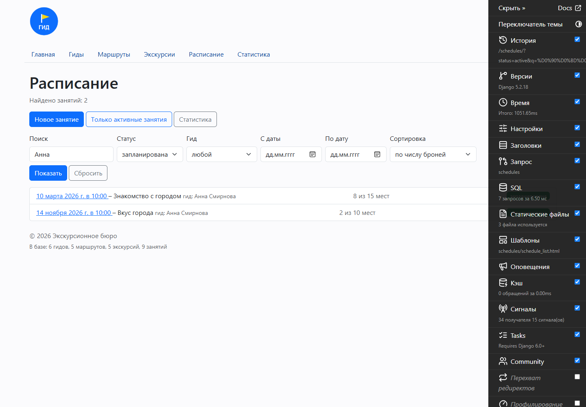
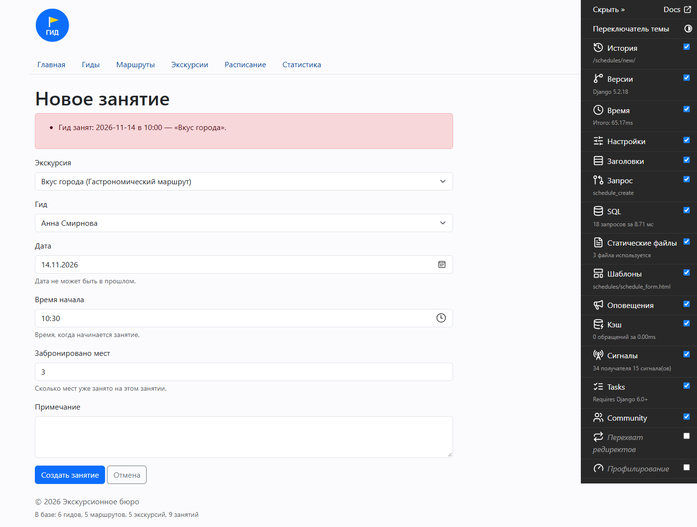
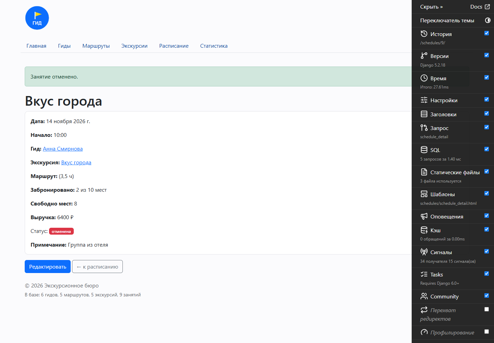
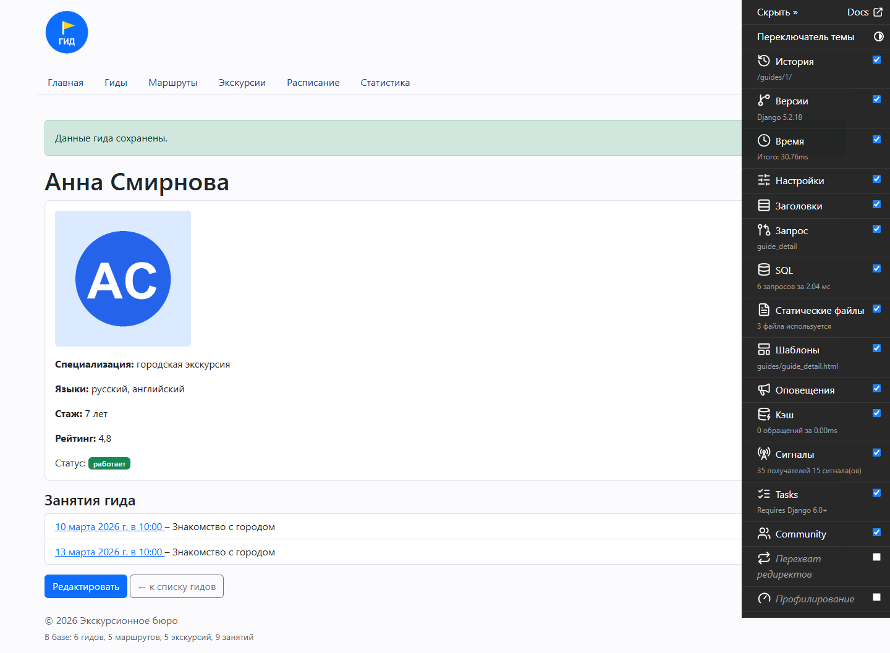

# Отчёт по практической работе № 11

## 1. Общие сведения

| Поле | Значение |
| --- | --- |
| Дисциплина | «Технологии разработки приложений на базе фреймворков» |
| Практическая работа | № 11 |
| Тема | «Формы в Django» |
| Индивидуальный проект | «Сервис управления туристическими гидами» |
| Группа | ЭФБО-09-24 |
| ФИО | Коломоец Г.К. |
| Вариант | 443 |

К началу работы проект был в состоянии после ПР10: модели, миграции,
админка и представления на ORM. В ПР11 добавлены формы Django: фильтр
расписания через GET-параметры, создание и редактирование занятия на
`ModelForm`, проверка даты и занятости гида, отмена занятия сменой статуса
и загрузка фотографии гида.

## 2. Цель работы

Освоить работу с формами Django и применить их в индивидуальном проекте:
описать формы и связать их с моделями, реализовать фильтрацию списка через
GET-параметры, проверять введённые данные и показывать ошибки, создавать
и редактировать записи через `ModelForm`, контролировать дату и занятость
гида, менять статус вместо удаления записи, а также организовать загрузку
изображения и защиту POST-запросов.

## 3. Выполненные материалы Яндекс Практикума

Материалы курса «Бэкенд-разработка» по теме форм выполнены самостоятельно.

| Раздел | Выполненные темы | Отметка |
| --- | --- | --- |
| Курс «Бэкенд-разработка» | «Формы Django»: класс `Form`, поля и виджеты, `GET` и `POST`, `is_valid()`, `cleaned_data`, валидация полей и формы | ✓ |
| Курс «Бэкенд-разработка» | «ModelForm и файлы»: связь формы с моделью, `instance` при редактировании, `save()`, `request.FILES`, `enctype="multipart/form-data"` | ✓ |
| Курс «Бэкенд-разработка» | Защита форм: ``, обработка POST-запросов, сообщения `messages` и `redirect` после сохранения | ✓ |

## 4. Доработка индивидуального проекта

### 4.1. Созданные формы и их назначение

| Форма | Файл | Назначение |
| --- | --- | --- |
| `ScheduleFilterForm` | `schedules/forms.py` | фильтр списка занятий: `q` (поиск по экскурсии и гиду), `status` (список из `ScheduleStatus.choices`), `guide` (`ModelChoiceField`), `date_from`/`date_to`, `sort` (5 вариантов) |
| `ScheduleForm` | `schedules/forms.py` | `ModelForm` для создания и редактирования занятия: `excursion`, `guide`, `date`, `start_time`, `booked`, `note` |
| `GuideForm` | `guides/forms.py` | редактирование гида, включая фотографию: поля модели плюс `photo` |

У `ScheduleFilterForm` список гидов подставляется в `__init__`, а не на
уровне класса: иначе набор сотрудников «застыл» бы при первом импорте
модуля. У `ScheduleForm` заданы подписи (`labels`), подсказки
(`help_texts`) и виджеты: календарь для даты, часы для времени, число для
мест, многострочное поле для примечания.

### 4.2. Фильтрация через GET-параметры

Список занятий принимает параметры из адреса и передаёт их форме:

```python
form = ScheduleFilterForm(request.GET or None)
queryset = Schedule.objects.with_related()
if form.is_valid():
    queryset = form.filter_queryset(queryset)
else:
    queryset = queryset.order_by("date", "start_time")
```

`filter_queryset()` применяет Q-поиск по названию экскурсии и имени гида,
фильтр по статусу, гиду и периоду, затем сортирует по одному из пяти
вариантов. Некорректные параметры не ломают страницу: показываются все
занятия, а форма выводит сообщения об ошибках. При переходе по страницам
параметры сохраняются — в ссылки подставляется строка запроса без `page`.

### 4.3. Валидация данных и обработка ошибок

- `clean_date()` не даёт запланировать занятие на прошедшую дату
  (`value < timezone.localdate()` → `ValidationError`);
- `clean()` проверяет число мест: если броней больше
  `max_participants`, ошибка добавляется к полю `booked` через
  `add_error()`;
- там же проверяется занятость гида (см. 4.5), ошибка выводится как общая
  для формы;
- `clean_photo()` в `GuideForm` ограничивает размер файла 2 МБ.

Шаблон показывает ошибки двух видов: общие (`form.non_field_errors`)
в красном блоке и ошибки полей под каждым полем. Введённые значения
не теряются: форма заполняется из `POST`.

### 4.4. Создание и редактирование через ModelForm

`schedule_create()` на GET отдаёт пустую форму, на POST — проверяет её и
при успехе сохраняет: `form.save()`, затем `messages.success()` и
`redirect` на карточку занятия. `schedule_edit()` работает так же, но
передаёт форму существующий объект: `ScheduleForm(request.POST,
instance=schedule)`, поэтому `save()` обновляет запись, а не создаёт новую.
Если занятия с таким id нет, обе функции возвращают страницу 404 — проверка
вынесена в `_find_schedule()` и `_not_found()`.

### 4.5. Проверка даты и доступности гида

Помимо запрета прошедшей даты, форма проверяет, что гид не занят:

```python
duration = timedelta(hours=float(excursion.route.duration_hours))
start = datetime.combine(day, start_time)
end = start + duration
others = (Schedule.objects.filter(guide=guide, date=day)
          .exclude(status=ScheduleStatus.CANCELLED)
          .select_related("excursion", "excursion__route"))
if self.instance.pk:
    others = others.exclude(pk=self.instance.pk)
```

Сравниваются интервалы `[начало, начало + длительность маршрута)`:
пересечение находится условием `start < other_end and other_start < end`.
Отменённые занятия не учитываются — они не занимают время гида, а при
редактировании занятие не сравнивается само с собой.

### 4.6. Отмена занятия и смена статуса

Отмена сделана в два шага: `schedule_cancel()` на GET показывает страницу
подтверждения с данными занятия, на POST вызывает `schedule.cancel()` —
статус меняется на `cancelled`, запись остаётся в базе. Поэтому занятие
не удаляется из истории, не блокирует гида и не попадает в статистику как
состоявшееся. Обе формы — создания и отмены — содержат ``:
без токена POST отклоняется с кодом 403, а прямой GET-запрос отмену не
выполняет.

### 4.7. Загрузка фотографии гида

| Что изменено | Как |
| --- | --- |
| модель | `Guide.photo = ImageField(upload_to="guides/", blank=True)` |
| форма | `GuideForm` с полем `photo` и виджетом `FileInput`, проверка размера в `clean_photo()` |
| представление | `guide_edit()` принимает `GuideForm(request.POST, request.FILES, instance=guide)` |
| шаблон | `<form method="post" enctype="multipart/form-data">`, превью текущего фото |
| настройки | `MEDIA_URL = "media/"`, `MEDIA_ROOT = BASE_DIR / "media"` |
| отдача файлов | в `guideservice/urls.py` при `DEBUG` подключён `static(settings.MEDIA_URL, ...)` |

## 5. Результат работы

- созданы три формы: фильтр, создание/редактирование занятия, редактирование гида;
- список занятий фильтруется через GET-параметры, параметры сохраняются
  в пагинации;
- работают проверки: прошедшая дата, превышение числа мест, занятость гида
  с учётом длительности маршрута, размер загружаемого файла;
- создание и редактирование занятия выполняются через `ModelForm`,
  после сохранения показывается сообщение и открывается карточка;
- отмена меняет статус, а не удаляет запись;
- добавлена загрузка фотографии гида с отдачей файлов из `media/`;
- ошибки форм видны в интерфейсе, некорректные параметры фильтра не ломают страницу.

## 6. Проверка

```
python manage.py check
System check identified no issues (0 silenced).

python manage.py makemigrations --check --dry-run
No changes detected

pytest -v
107 passed

flake8 . --extend-exclude=.venv
(без замечаний)
```

Тестовые сценарии проверены в браузере: фильтр с заполненными полями даёт
нужный список; форма создания с прошедшей датой показывает ошибку; занятый
гид получает сообщение «Гид занят: дата время — «экскурсия»»; редактирование
сохраняет изменения; отмена требует подтверждения и переводит занятие
в статус «отменена»; обращение к несуществующему занятию даёт 404;
фотография гида загружается и видна в карточке.









Остальные снимки — в `docs/screens/`: `12_create_form.png` (форма
создания), `13_error_date.png` (прошедшая дата), `15_edit_form.png`
(редактирование), `16_cancel_confirm.png` (подтверждение отмены),
`18_guide_form.png` (форма гида), `20_404_schedule.png` (404).

## 7. Git

Результат зафиксирован коммитом
`PR11: формы фильтрации, создания и редактирования занятий` (9267b03):
формы `ScheduleFilterForm`, `ScheduleForm` и `GuideForm`, представления
создания, редактирования, отмены и редактирования гида, маршруты, шаблоны
форм, настройки `MEDIA_*`, поле `photo` с миграцией, тесты форм и README.

## 8. Вывод

В ПР11 приложение получило полноценный ввод данных: вместо ручного разбора
`request.GET` и `request.POST` используются формы Django, которые сами
проверяют типы, обязательность и правила предметной области. Валидация
живёт в формах (`clean_date`, `clean`, `clean_photo`), а не в шаблонах,
поэтому одинаково работает и в браузере, и в тестах. `ModelForm` связал
форму с моделью и убрал дублирование полей, `instance` разделил создание и
редактирование, а отмена через смену статуса сохранила историю занятий.
CSRF-токен и проверка файлов закрывают две типичные уязвимости форм.
